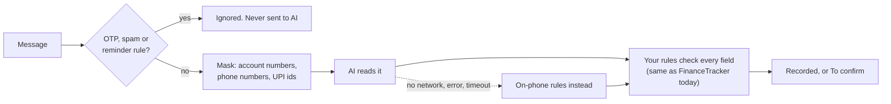
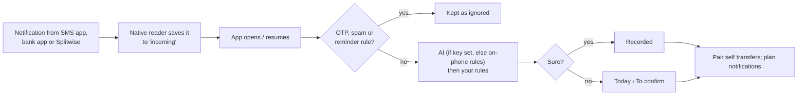

# Plan: one Android app for your day, your home and your money

Status: **draft v3 for your review**. Nothing is built yet. v2 redesigns the app around how
you use it, instead of copying both apps screen for screen, and adds notifications.

---

## 1. In short

- **One app, installed from an APK file.** It has no login, no account and no server, and all data stays on the phone.
- **One simple model for everything:** *routines* (things you do), *money* (things you
  spend) and *rules* (how incoming things get filed). Supplements, chores, bills to
  confirm and Splitwise to-dos are all just routines or money, shown the same way.
- **Three tabs instead of nine screens:**
  - **Today** is everything that needs you now.
  - **Insights** is how it's going.
  - **Setup** is what you track.

  One **+** button covers quick adds.
- **Notifications come from the phone itself.** Two or three a day by default, grouped, with
  buttons that work without opening the app. No server and no Google push service.
- **Bank messages are read on the phone** from your notifications. By default, rules on the phone file them.
  **Optional AI parsing:** paste your own API key in Setup and each message is read by the AI
  first, then checked by the same rules. MacroDroid, Vercel,
  cron jobs, Telegram, Google Sheets and Google sign-in all go away.
- **The logic and its ~4,900 lines of tests come across.** The screens are rebuilt to be simpler.
  Expect about half of today's code (≈17,000 → ≈7,500 lines without tests) and an APK under 10 MB.

---

## 2. Decisions I need from you

My recommendation is listed first. The plan assumes these recommendations.

| # | Question | Recommended | Alternative |
|---|---|---|---|
| ✅ 1 | **How bank messages are read** | **Decided:** rules on the phone by default; **optional AI parsing with your own API key** (see §5a). | — |
| 2 | **Google Sheets editing goes away** | Edit in the app; export CSV or JSON any time | Two-way Sheets sync: brings back most of the complexity |
| 3 | **Backups** | Weekly automatic backup file to a folder you pick, plus "Back up now". Android cloud backup off | Android cloud backup to Google Drive |
| 4 | **Notification budget** | Morning and evening by default, afternoon optional, Sunday weekly look-back on. New-transaction alerts off (they come in the evening wrap-up) | Turn any on or off in Setup |
| 5 | **How you install it** | Sideload the APK from GitHub Releases | Play Store: restricts apps that read notifications/SMS, and slow reviews |
| 6 | **Where the code lives** | New `app/` folder in the LifeTracker repo; `web/` deleted and FinanceTracker archived after the switch | A new repo you create |
| 7 | **Name** | "LifeTracker" | Your pick |

---

## 3. The design idea: one map for everything

Today the two apps hold the same kinds of things in different shapes: supplements and
chores each have their own logs, pause, undo and cards, and money has its own review
list, its own to-dos ("add to Splitwise", "enter balance") and 13 settings lists. The new
app uses **four building blocks**, and every screen is made from them.

| Block | What it is | Covers |
|---|---|---|
| **Routine** | Something you do on a schedule | Supplements, chores, any future habit (workout, water, reading), recurring bills |
| **Log** | A routine done or missed on a day | Today's "taken", "done", "missed" |
| **Money entry** | A transaction | Bank messages, pasted or typed expenses, flatmate settle-ups |
| **Rule** | "When a message contains *X*, do *Y*" | Category rules, payee rules, aliases, flatmate, own accounts, spam, reminders |

Two supporting lists hold your **accounts** (bank or card, last 4 digits, which card bills
go to) and **categories** (split by default? counts as spending?).

### One routine model for supplements and chores

A routine has a few plain-language settings:

| Setting | Choices | Supplement default | Chore default |
|---|---|---|---|
| **When** | Every day · Every N days (from the last time you did it) · On certain weekdays (optionally every other week, or only the 1st/2nd/3rd/4th/last week of the month) | Every day | Weekdays you pick |
| **Time of day** | Morning · Afternoon · Evening · Anytime | Morning | Anytime |
| **If missed** | **Let it go** (it counts as missed and the next one comes as usual) · **Keep it until done** (it stays on Today as overdue) | Let it go | Keep it until done |
| **Effort** (optional) | Points, used to balance a busy day | — | 10 |
| **Area** | Health · Home · or your own label | Health | Home |
| **Details** (optional) | Dose, unit, notes… | dose, unit | notes |
| **Pause** | Until a date, or until I resume | | |

**"If missed" is the only real difference** between the supplement and chore logic today.
Making it a setting removes a whole parallel code path, and it lets you have, for example, a
supplement that carries over, or a chore that doesn't. Both existing scheduling engines are
kept underneath and tested as they are; one `isDue(routine, day)` picks the right one.

"Twice weekly" is approximated today as every 3 days. With weekdays it becomes exact.
Your existing items move over with today's behaviour, and you can change them afterwards.

### Why this lowers effort for you

1. **One place to act, one place to look, one place to set up.** You never wonder which
   screen something lives on.
2. **Every row works the same way**, whether it's a supplement, a chore, a transaction to confirm
   or a Splitwise to-do:
   - tap the circle = done
   - tap the row = details
   - swipe = missed / move / more
3. **Only what needs you is shown.** Empty sections disappear, and an empty Today says "All done".
4. **Undo instead of "Are you sure?"** Only deleting a routine asks first.
5. **The app asks at the right moment, once.** "Always file Swiggy as Food?" appears right after you
   correct one; "What's your HDFC balance?" appears on the 1st.
6. **At most three headline numbers per screen**, and the same period control (Week · Month,
   ‹ › to go back) everywhere.
7. **Defaults over questions.** A new routine needs only a name and when; everything else is
   under "More".
8. **Plain words:** *To confirm*, *Add to Splitwise*, *Spent*, *Owed*, *Missed*.

---

## 4. The screens

### Today (act)

```
┌─────────────────────────────────────┐
│ Tue 17 Nov        4 left · ₹1,240   │  ← one summary line
├─────────────────────────────────────┤
│ OVERDUE                             │
│ ○ Clean beard        since Tue  ⋯   │
│ MORNING                             │
│ ○ Vitamin D3   60000 IU         ⋯   │
│ ○ Omega-3      1000 mg          ⋯   │
│ EVENING                             │
│ ○ Laundry                       ⋯   │
│ MONEY · 3 to confirm                │
│ ○ Swiggy   ₹340   Food          ⋯   │
│ ○ Add ₹1,200 rent split to Splitwise│
│ ○ Enter HDFC balance (1st)          │
│ DONE TODAY (5)                    ▸ │  ← collapsed
└─────────────────────────────────────┘
                [ + ]
```

- Overdue first, then by time of day, then money to-dos. Chores and supplements are mixed
  by time of day, not split by type.
- **The money to-dos are today's Review, Splitwise and balance screens, folded into one list.**
  A transaction that parsed cleanly never shows up here; it is just recorded.
- A day that's over its effort points shows one warning line ("Heavy day: 140/100, move
  something?"). The capacity calendar opens from "move".
- The AI insight card is gone; the summary line plus the weekly look-back replace it.

### Insights (look)

One period control at the top (Week · Month, ‹ ›) drives three sections:

- **Spending:** *Spent*, *vs last period*, *Owed with flatmate*; one bar chart by category (tap a
  bar for its transactions); one "this month vs last" running line; account balances and
  card dues below. "All transactions" opens the full searchable list, where any entry can be edited.
- **Habits:** completion % and a list of routines with streaks; the year heatmap is collapsed.
- **Home:** done on time, missed, and a load-per-day calendar (today's capacity calendar).

**Tap any day anywhere** to get one day view with everything on it: what was done or missed, and what was spent.
This replaces the separate Calendar, Day and Trends pages and the date-range page.

Compared with today's money Home: 5 range presets become Week/Month with arrows (last month is
one tap back), about 8 tiles become 3 numbers, and 4 charts become 2. The 6-month view and
"split by account" stay one tap deeper.

### Setup (configure)

- **Routines:** the list grouped by area; add, edit, pause.
- **Money:** **Accounts** (bank/card, last 4 digits, pays card bills, own-account text),
  **Categories** (split by default, counts as spending), **Rules**.
- **Notifications:** times, which ones are on, and the reader status.
- **Data:** back up now, backup folder, export CSV, import, about.

**Rules become one list.** Each rule is "when a message contains ___" plus one action:

| Action | Replaces today's |
|---|---|
| File as… (vendor / category / sub-category / my share) | payee rules, category rules, aliases |
| Settle-up with flatmate | flatmate identifiers |
| Between my own accounts | own-account identifiers |
| Ignore: spam | spam phrases |
| Ignore: future payment reminder | reminder phrases |

Card last-4 and "known sources" move into **Accounts**; "split default" and "not counted as
spending" become switches on a **Category**. **13 lists become 3 screens.** The order in which
rules apply stays exactly as today, so behaviour doesn't change.

### + (quick add)

Three choices: **Expense** (amount, what, category; the rest is optional), **Paste a
message** (fills the expense form), **New routine**.

### First run

Three steps:
1. Allow notifications.
2. Allow reading notifications for bank messages, with one sentence on why and what is never sent anywhere.
3. Import a backup, or start fresh with sample categories.

---

## 5. Notifications

**How they work:** the app schedules them on the phone with Android's own alarm service. They
arrive with the app closed and need no internet. After every change, and every time the app
opens, the app recalculates the next 7 days of notifications, so their content stays right.

| Notification | When (default) | Content | Buttons |
|---|---|---|---|
| **Morning** | 09:00 | "4 to do this morning: Vitamin D3, Omega-3…" + balance task on the 1st/5th | **All done** · Open |
| **Afternoon** (off) | 13:00 | Afternoon routines still left | **All done** · Open |
| **Evening wrap-up** | 20:30 | What's still left, overdue chores, "3 to confirm, 1 to add to Splitwise", tomorrow's chores | **Snooze 1 h** · Open |
| **Weekly look-back** | Sun 19:00 | "Habits 92% · Spent ₹8,400 (−12%) · 2 chores missed" | Open |
| **Reader check** | only when needed | "No bank messages seen for 3 days. Is the reader still on?" | Open settings |
| **New transaction** (off) | on capture | "₹340 at Swiggy, filed as Food" | **Looks right** · Open |

- **Grouped and capped:** one notification per time slot, never one per item. That is two to
  three a day by default.
- **Buttons work without opening the app.** The tap is saved to the same local queue the bank
  messages use, the matching notification is cleared, and the app applies it the next time it opens.
- **The reader check replaces today's heartbeat and silence alerts.** Every captured message
  pushes the check 3 days further out, so it fires only if messages stop.
- Each notification has its own Android channel, so you can also silence one in phone settings.
- Times are inexact by a few minutes. This avoids the "exact alarms" permission and saves battery.

---

## 5a. AI parsing (optional, your own key)

**Off until you add a key.** Without a key, everything works on the phone with rules, and
nothing leaves it.

**Turning it on:** Setup → Money → **AI parsing** → choose a provider and paste your key →
**Test**. The test sends one sample message and shows the result. The default provider is Groq
(what FinanceTracker uses today). Any OpenAI-compatible service also works by entering its address and model name.

**How a message is read when AI is on:**



- **The model proposes, your rules decide.** This is FinanceTracker's decision 9, kept as is. Card numbers, payee
  rules, own accounts and flatmate rules always override the AI. Doubtful answers still go to To confirm.
- **Less text leaves the phone than today.** OTPs, spam and reminders are filtered first and never
  sent. Account numbers, phone numbers and UPI ids are masked before sending; the last 4 digits are matched
  on the phone, so the AI doesn't need them. Only the masked message text is sent: never your history,
  balances or names from your lists.
- **It never blocks.** If the call fails (offline, bad key, timeout ~10 s), the on-phone rules handle the
  message right away and it is marked `read without AI`. There are no retries and no stuck queue.
- **Your corrections improve the AI too.** Your latest corrections, the ones the old weekly
  job used, are sent as short examples with each request, masked the same way. This
  needs no weekly job: the examples are refreshed whenever you correct something.
- **The key is stored encrypted** with Android's secure key storage. It never appears in backups or
  exports, and the AI provider's address is the only place it is ever sent.
- **Setup shows what is used:** "AI read 212 messages this month · 3 fell back to rules".
- **Accuracy target:** the same 95% bar on your past messages applies **with AI off**, so the app is
  fully usable without a key. With AI on, the target is FinanceTracker's current accuracy or better.

**Cost of the option:** the app needs Android's internet permission (it can't be added only when
a key exists). Network access is limited in code to the one provider address you set. No other
part of the app makes network calls, and a test checks that only the AI client calls `fetch`.

---

## 6. What the two apps do today

| Area | LifeTracker | FinanceTracker |
|---|---|---|
| Screens | Today, Calendar, Day, Trends, Manage | Home (ranges, tiles, 4 charts, balances, list), Review, Settings, Add/paste |
| Data | Google Sheet: supplements, log, chores, chore_log, chore_moves, settings, ai_summary | Google Sheet: a tab per month + Ledger, Inbox, Config (13 lists), Learning, Balances, State, SystemLog |
| Automation | Daily cron: Telegram reminders 13:00 / 20:00, chores 21:00, AI digest 08:00 | Hourly cron: parse messages; nightly rollover, summary, alerts; weekly AI learning |
| Outside services | Vercel, Google sign-in, Sheets, Groq, Telegram | + cron-job.org, MacroDroid, Apps Script backup |
| Stack | Next.js 16, React 19, Tailwind 4, zod, NextAuth | Next.js 16, React 19, plain CSS, `jose` sign-in |
| Code / tests | ~6,700 / ~1,300 lines | ~10,500 / ~3,600 lines |

---

## 7. Review findings

### Worth keeping

- **The logic is already separated from storage.** LifeTracker has its due/streak/compliance logic and its
  chores logic (patterns, overdue, moves, capacity, missed). FinanceTracker has money, reports, review,
  rules, OTP/spam/reminder filters, dedupe, pairing, balances and analytics. All of these take data in and return
  answers.
- **There is one rule for "what counts as spending"** (`spendOf`), and every number uses it.
- **The hand-built SVG charts** (~700 lines, with tooltips and table views) are light, and they will be shared by both areas.
- **Doubtful entries are never hidden.** They go to review with their reasons.
- **The tests are strong.** The chores tests (1,000 lines) and FinanceTracker's logic tests
  (1,200 lines) both come along.

### What goes away on the phone

About half of FinanceTracker's server code, and a good part of LifeTracker's, exists only
because the database is a Google Sheet on a free web host:

| Cost today | On the phone |
|---|---|
| Read-limit errors, caching, retry logic (both apps) | Gone: a local file |
| Column maps, self-healing tabs (`schema.ts`, `bootstrap.ts`, `workbook.ts`, `configlists.ts`, ~1,600 lines) | Real tables with numbered upgrades |
| Month tabs, rollover, Ledger mirroring | A month is a date filter |
| Messages over HTTP, Apps Script backup path, drain lock | One local capture queue |
| Heartbeat, silence and stuck alerts, cron dispatch | The reader check notification |
| IST conversions everywhere | The phone's clock is local time |
| Sign-in, secrets, request checks | No URL, nothing to sign in to |
| Telegram code in both apps | Phone notifications |
| `id = largest + 1` after reading a whole tab | Random unique ids |

### Fix while moving

- LifeTracker has **two copies** of the log, undo, pause and resume code (supplements vs chores). The routine model
  leaves one.
- **Big screens:** `TxnList.tsx` (594 lines), money Home (477), `AddTxn.tsx` (368). They are
  rebuilt smaller, as one shared row and one shared editor.
- **Money stored as floats** with `round2` everywhere → store whole paise.
- **Duplicates across the two apps:** two sets of date helpers, two AI clients (→ one, optional), two Telegram clients, two
  styling systems and two test runners → one of each, or none.
- **Leftovers:** `Sheet.gs`, `apps-script/`, 14 setup/repair scripts.

---

## 8. Technology

| Option | Reuses today's code | APK size | Effort | |
|---|---|---|---|---|
| **Capacitor + React + Vite** (web code wrapped as an Android app, plus a small native part) | Logic, tests, charts, some UI pieces | ~5–8 MB | Lowest | **Recommended** |
| React Native / Expo | Logic and tests | ~20–30 MB | High | |
| Native Kotlin | Nothing | ~3–5 MB | Highest | |

**What we use, and nothing more:**

- React 19 and strict TypeScript.
- **Vite**, which replaces Next.js because there is no server.
- Tailwind 4.
- Capacitor plus its official app, local-notification, file and share plugins, and `@capacitor-community/sqlite`.
- **One native plugin of our own (Kotlin, ~200 lines)**, which reads bank notifications and saves notification button taps.
- The plain `fetch` built into the browser for the optional AI call (no AI SDK). The key is held in the
  Android Keystore through a small secure-storage plugin.
- `zod/mini`, only to check imported backups.

No state, router, chart or date libraries: three tabs and a few sheets don't need them.

---

## 9. How it's built

### Folders

```
app/
  android/          Android project + the native plugin (reader + notification buttons)
  src/
    logic/          pure functions: dates, money, routines (both schedule engines),
                    parse, rules, review, reports, balances, pairing, insights, notifications plan
    data/           database tables, upgrades, store, backup/export/import, test store
    phone/          notifications, capture queue, files, back button
    ui/             one row, one editor sheet, period control, charts, bottom bar
    screens/        today, insights, setup, day, quick-add, first-run
  tests/            unit tests + anonymised real bank messages
```

**Rule:** `logic/` never imports from `data/`, `phone/` or `ui/`, and a test enforces it. Even
*which notifications to send* is a pure function: `planNotifications(data, now) →
list`. That makes it testable, and the phone code only hands that list to Android.

### Tables (one database file on the phone)

| Table | Holds |
|---|---|
| `routines` | name, area, when (schedule), time of day, if missed, effort, details, pause, start date |
| `routine_moves` | one-off "do it on another day" |
| `logs` | routine, day, done or missed, time, note |
| `transactions` | date, type, account, vendor, category, sub-category, amount and my share (paise), split, in Splitwise, status, reasons, original text, parser's category, fingerprint |
| `incoming` | the native queue: captured messages and notification button taps, until the app processes them |
| `accounts` | name, bank or card, last 4 digits, source names, pays card bills, own-account text |
| `categories` | name, split by default, counts as spending, order |
| `rules` | match text, action, values |
| `balances` | balance entries per account |
| `settings` | notification times and switches, effort per day, backup folder |

The app loads everything into memory on open (a few thousand rows a year). Each change is
written to the file in one step, then the screen updates.

### A bank message, end to end



---

## 10. Coding rules

1. **One place per rule.** "Is it due", "is it overdue", "does it count as spending" and "what to
   notify" each live in exactly one function.
2. **Decisions live in `logic/` and have tests.** Screens only show and collect.
3. **Plain names, no jargon**, in code and on screen.
4. **Small files:** a soft cap of ~250 lines, split by job.
5. **Paise for money, `YYYY-MM-DD` for days, random ids.**
6. **Every change is one database step**, so all of it saves or none does.
7. **Numbered database upgrades** that run once, in order.
8. **No dead code and no flags for features that don't exist.**
9. **Comments say *why*, not *what*.**
10. **Before merging:** typecheck, lint, tests, build, plus a screenshot a person looks at for any visual change.

---

## 11. Moving your data

1. A one-off script reads both Sheets and writes one backup file for the new app. It:
   - turns supplements and chores into routines, with today's behaviour (supplements "let it go",
     chores "keep until done")
   - merges both log tabs into `logs`
   - turns the month tabs into transactions (not the Ledger, so nothing counts twice)
   - turns the 13 Config lists into accounts, categories and rules
   - converts amounts to paise
2. **Setup → Data → Import**, then the app compares totals per month with the old apps
   and shows the result.
3. **Your past messages become the parser's test set**, because each kept its original text and
   the fields you accepted. Names and numbers are masked first. **Target before switching
   over: ≥ 95% of amounts, dates and debit/credit right; the rest goes to "To confirm",
   never wrong and hidden.**

---

## 12. Build, install, update

- GitHub Actions builds a **signed APK** on each version tag and attaches it to a GitHub Release.
- **Keep the signing key in two places** (a GitHub secret, plus your own copy). Without it, an
  update can't install over the old app.
- **Install or update:** download the APK on the phone and open it. Data stays across updates.
- **Permissions:** notification reader, post notifications, and (asked once) skip battery
  optimisation so the reader isn't killed. Internet, used only by the optional AI call.

---

## 13. Phases

Each phase is one pull request, merged when its checks pass. The old apps keep running until phase 8.

| Phase | Work | Done when |
|---|---|---|
| 0. Decide | Your answers to §2 | Plan final |
| 1. Skeleton | `app/` with Vite, React, Tailwind and Capacitor; three tabs and +; light/dark; debug APK built in CI | It installs and opens on your phone |
| 2. Logic | Move and merge the pure logic and tests; the routine model with both schedule engines; paise; one date module | All moved tests pass, plus new routine tests |
| 3. Data | Tables, upgrades, store, backup/export/import | Export → import round trip is identical |
| 4. Today + routines + notifications | Today list, shared row and editor, Setup › Routines, capacity warning and move, `planNotifications`, morning/evening/weekly notifications with buttons | You can run your day from the app and its notifications |
| 5. Money capture | On-phone parser + test set, optional AI parsing (key setup, masking, fallback, test button), native reader, `incoming` queue, To-confirm rows, Splitwise/balance to-dos, quick add and paste, Accounts/Categories/Rules, one-tap rule suggestions, reader check | Parser meets the 95% target; a real bank message becomes an entry |
| 6. Insights | Period control, Spending/Habits/Home sections, day view, all transactions | Totals match the old apps for the same months |
| 7. Move data | Export script, import, totals check | Your real data is in and matches |
| 8. Switch over | 1–2 weeks on the app alone, with backups on; then turn off MacroDroid, cron, Telegram and Vercel; delete `web/`; archive FinanceTracker; revoke the Google service accounts and the Groq / Telegram keys | Nothing old left running, no secrets anywhere |

---

## 14. Risks

| Risk | Handling |
|---|---|
| The on-phone parser is less accurate than AI | Add your key and AI does the reading; without one, the 95% target on your own messages applies, unsure entries go to To confirm, and one-tap rules help |
| The AI provider is down or the key expires | The on-phone rules take over automatically; Setup shows "AI failing: check key" |
| Message text sent to the AI provider | Only when you add a key; OTP, spam and reminders are never sent; numbers and ids are masked |
| Android stops the reader to save battery | Battery exemption asked once; the reader check notification; a red banner in Setup |
| Notification content is out of date | Re-planned after every change and every open; buttons cancel the notification they answer |
| A lost phone | Weekly backup file plus export; import tested in CI |
| A lost signing key | Two copies; written in the README |
| Too many notifications | Grouped per time slot, 2–3 a day by default, each switchable |
| A bank changes its message format | The entry lands in To confirm with its text; fix it with a rule or a parser update plus a test |

---

## 15. Deleted at the end

Next.js server code and `api/` routes, both sign-in systems, both Sheets clients and the `google-*`
packages, column maps, bootstrap / workbook / rollover / Ledger code, the drain lock and State
tab, heartbeat and alerts, Telegram, cron routes, Apps Script, `Sheet.gs`, the 14 scripts, the
Vercel projects and every secret they held.

---

## Later (not in this plan)

The routine model is made to grow without new plumbing: workouts, water, reading or
recurring bills are just routines in a new area. FinanceTracker's backlog idea of an
assistant that sees across your whole life fits on top of this one local map. That
can be decided later, keeping in mind that it would mean data leaving the phone.
