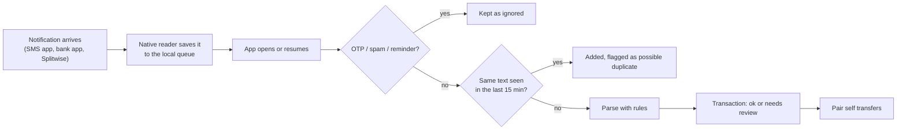

# Plan: one Android app for habits, chores and money

Status: **draft for your review**, nothing built yet. Written 17 Nov 2026 after
reading both repos end to end.

---

## 1. In short

- **One app, installed from an APK file.** It has no login, no account and no server. All data lives in one
  database file on the phone.
- It **replaces both web apps**: LifeTracker (supplements, chores) and
  FinanceTracker (bank messages, review, spending, balances, flatmate splits).
- **The app reads bank messages itself.** It watches phone notifications, so MacroDroid,
  Vercel, cron-job.org, Telegram, Google Sheets and Google sign-in are no longer needed.
- **Most of the code comes across.** The scheduling, chore, spending, balance and rules
  logic is already written as plain functions with about 4,900 lines of tests,
  and those move over almost unchanged. The parts that go are the ones that only exist
  to work around Google Sheets and hosting.
- **Rough size:** about half the code of the two apps combined (≈17,000 lines today
  without tests → ≈8,500), with an APK under 10 MB.

---

## 2. Decisions I need from you

My recommendation is listed first in each row. Everything below assumes these
recommendations; changing one changes the plan as noted.

| # | Question | Recommended | Alternative and what it changes |
|---|---|---|---|
| 1 | **How bank messages are read.** Today an AI service (Groq) reads each message, which means the text leaves the phone. | **Read them on the phone with rules.** Anything unclear goes to Review, and every correction teaches a rule. The app gets *no internet permission at all*, which makes "all data local" a guarantee rather than a promise. | **Optional AI with your own key.** Accuracy is better on new kinds of messages, but the app needs internet permission and the message text goes to the AI provider. This can be added later without rework. |
| 2 | **Editing in Google Sheets goes away.** | Edit everything in the app, and export to CSV or JSON whenever you like. | Keeping Sheets in sync both ways would bring back most of the complexity being removed. |
| 3 | **Backups.** A lost phone means lost data unless there is a copy. | A **weekly automatic backup file** saved to a folder you pick (for example Downloads, or a USB-synced folder), plus a "Back up now" button. Android's own cloud backup is switched off. | Android cloud backup (Google Drive): it works with no effort, but the data then sits with Google. |
| 4 | **Features to drop or simplify** (details in §5). | Drop Telegram, heartbeat alerts, editable AI prompts, and the AI daily digest (replaced by an on-phone summary card). Replace weekly AI learning with "always file *Swiggy* as *Food*?", offered as a one-tap suggestion right after you correct a row. | Keep any of them; each one kept adds back a little code. |
| 5 | **How you install it.** | **Sideload the APK** from GitHub Releases. Google Play restricts apps that read notifications or SMS, and its review process slows every update. | Play Store: needs a developer account, a privacy review and possibly a permission declaration. |
| 6 | **Where the code lives.** | A new `app/` folder in the **LifeTracker** repo. `web/` stays live until you switch over, then it is deleted and the FinanceTracker repo is archived. | A brand-new repo. This is cleaner, but you would create it and give me access. |

---

## 3. What the two apps do today

| Area | LifeTracker | FinanceTracker |
|---|---|---|
| Main screens | Today (supplements due, chores, capacity meter, AI insight), Calendar, Day view, Trends (year heatmap, streaks, compliance), Manage | Home (date ranges, totals, donut, pace charts, monthly bars, balances, spend by account, list), Review, Settings, Add / paste a transaction |
| Data | Google Sheet: `supplements`, `log`, `chores`, `chore_log`, `chore_moves`, `settings`, `ai_summary` | Google Sheet: one tab per month plus `Transaction Ledger`, `Inbox`, `Config` (13 lists), `Learning`, `Balances`, `State`, `SystemLog` |
| Automation | One daily cron: Telegram reminders at 13:00 and 20:00, chores at 21:00, AI digest at 08:00, auto-resume of paused items | Hourly cron: parse new messages; nightly month rollover, summary and alerts; weekly AI learning |
| Outside services | Vercel, Google OAuth, Sheets API, Groq, Telegram | Vercel, Google OAuth, Sheets API, Groq, Telegram, cron-job.org, MacroDroid, Apps Script backup |
| Stack | Next.js 16, React 19, Tailwind 4, zod, NextAuth | Next.js 16, React 19, plain CSS, custom sign-in with `jose` |
| Tests | 169 tests, ~1,300 lines (`node --test`) | ~270 tests, ~3,600 lines (`tsx --test`) |

---

## 4. Review findings

### Worth keeping (moves over almost as-is)

- **The logic is already separated from storage in both apps.** LifeTracker has `lib/core/logic.ts` (due dates, streaks,
  compliance) and `lib/chores/logic.ts` (patterns, overdue, moves, capacity,
  missed). FinanceTracker has `money`, `reports`, `review`, `rules`, `otp`,
  `dedupe`, `pairing`, `balances`, `analytics`, `ranges` and `manual`. They take data and return
  answers, and none of them talk to Sheets.
- **There is one rule for "what counts as spending"** (`spendOf` / `isExcluded`), and every total
  and chart uses it. That is the right pattern, so it stays.
- **Charts are hand-built in SVG** (FinanceTracker, ~700 lines, with tooltips and
  table views). They are light, so LifeTracker's heatmap and calendar should share them rather than add a chart library.
- **Doubtful rows are never discarded.** They go to Review with their reasons attached.
- **The tests are good.** In particular `chores/logic.test.ts` (1,000 lines) and
  FinanceTracker's `logic.test.ts` (1,200 lines).

### What is costing you (and goes away on the phone)

About half of FinanceTracker's server code, and a fair part of
LifeTracker's, exists only because the database is a Google Sheet on a free host:

| Cost today | Why it exists | On the phone |
|---|---|---|
| Read-limit errors, caching layers, retry-on-429 (both apps; the last PR was about this) | Sheets allows 60 reads a minute | Gone: the database is a local file |
| Column-index map, self-healing tab and column creation (`schema.ts` 493 lines, `bootstrap.ts`, `workbook.ts`, `configlists.ts` 508 lines) | Sheet columns are the schema | Gone: real tables, numbered upgrades |
| Month tabs, rollover, Ledger mirroring, cross-month lookups (decisions 25, 29) | One tab per month keeps the Sheet readable | Gone: a month is just a date filter |
| Inbox journal over HTTP, Apps Script backup path, two-path dedupe, drain lock in a sheet | Messages arrive over the internet from MacroDroid | Simpler: one capture path on the phone writes straight to a local queue |
| Heartbeat, silence and stuck alerts, cron dispatch, State tab | Need to prove the phone→server pipe is alive | Gone |
| IST helpers everywhere (`istToday`, `+05:30` stamps) | Vercel runs in UTC | Gone: the phone's clock is local time |
| Sign-in (NextAuth / `jose`), secrets, `authz.ts` | A public URL holds private data | Gone: no URL |
| Telegram formatting and sending (`notify.ts`, `telegram.ts`) | The server can't show phone notifications | Replaced by local notifications |
| `id = largest id + 1` after reading the whole tab (both apps) | Sheets has no auto-ids; two quick writes can collide | Random unique ids |

### Things to fix while moving

- **Duplicated paths in LifeTracker.** Supplements and chores each have their own log, undo, pause,
  scheduled-resume and resume code (`log`/`logChore`, `deleteLog`/`deleteChoreLog`,
  `setActive`/`setChoreActive` and so on). Use **one `logs` table** and **one pause/resume
  helper**.
- **Very large components:** `TxnList.tsx` (594 lines), Home `page.tsx` (477),
  `AddTxn.tsx` (368). Split them by job: card, editor, list.
- **Money is stored as floats with `round2` everywhere.** Store whole **paise** as integers, and
  convert only when showing a number.
- **Two date libraries of the apps' own** (`core/logic.ts` date helpers and FinanceTracker's `dates.ts`):
  merge them into one `dates.ts`.
- **Two AI clients and two Telegram clients:** remove them all (or keep one AI client if you
  choose option 2 in decision 1).
- **Two styling approaches** (Tailwind and hand-written CSS): use one, Tailwind, with the
  shared colour variables LifeTracker already has (light and dark).
- **Two test runners:** use one, the built-in `node --test` (no extra dependency).
- **Leftover files:** `Sheet.gs`, `apps-script/`, 14 setup and repair scripts. Delete them.

---

## 5. What each feature becomes

| Today | In the new app |
|---|---|
| MacroDroid forwards bank SMS and app notifications to a URL | The app's own **notification reader** (an Android permission you switch on once) captures notifications from your SMS app, bank apps, Splitwise and SBI Card. It also catches RCS messages, which the old SMS trigger missed. Each message is saved to a local queue first, so nothing is lost even if reading it fails. |
| Groq reads each message | **Rules on the phone** (decision 1): amount, debit/credit, last 4 digits, payee, date, then your existing card map, aliases, payee rules, flatmate and own-account rules, OTP, spam and reminder filters. Unsure → Review. |
| Weekly AI learning (rules + spam phrases) | When you correct a row, the app offers **"Always file X as Y?"** (one tap). "Reject as spam" offers a phrase to block. Same safety checks as today (`validateRule`, `validateSpamPhrase`). |
| Telegram reminders 13:00 / 20:00 / 21:00 | **Phone notifications.** They are recalculated after every change and on every app open, and scheduled for the next 7 days, so they are right even when the app is closed. |
| AI morning digest | A **summary card** on Today, worked out on the phone: streaks, misses, chores load, spending vs last month. |
| Auto-resume paused items (cron) | Nothing needed: the logic already treats an item as active from its resume date. |
| Month rollover, Ledger | Nothing needed. |
| Balances, card dues, monthly balance tasks | Same logic, local tables. |
| Splitwise tracking (split, my share, "added to Splitwise") | Unchanged. |
| Edit in Google Sheets | Edit in the app, and export to CSV. |
| Settings: 13 Config lists, prompt editor | The same lists as simple editors. The prompt editor is dropped (no AI). |

---

## 6. Technology choice

| Option | Reuses today's code | APK size | Effort | Verdict |
|---|---|---|---|---|
| **Capacitor + React + Vite** (the web app wrapped as an Android app, plus a small native part) | Logic, tests and most components | ~5–8 MB | Lowest | **Recommended** |
| React Native / Expo | Logic and tests; all screens rewritten | ~20–30 MB | High | No |
| Native Kotlin | Nothing; everything rewritten | ~3–5 MB | Highest | No |

**What we use, and nothing else:**

- **React 19 + TypeScript (strict)**: same as today.
- **Vite** builds the app. It replaces Next.js, because there is no server any more.
- **Tailwind 4**: same as LifeTracker today.
- **Capacitor**, with its official plugins for app/back button, local notifications,
  files and share, plus `@capacitor-community/sqlite` for the database.
- **One small native plugin of our own (Kotlin, ~150 lines)** to read notifications.
- `zod/mini`, only to check a backup file before importing it.
- No state library, router library, chart library or date library. A ~40-line
  store and a ~30-line tab router are enough for five screens.

---

## 7. How the app is built

### Screens (bottom bar)

1. **Today**: the summary card, supplements due, chores (overdue / today / done, with
   mark missed and reschedule), spending today, and a "N to review" link.
2. **Money**: ranges, totals, charts, balances, the transaction list, and **+ Add / paste**.
3. **Review**: transactions needing review, balance tasks, rule suggestions.
4. **Habits**: the calendar, day view, trends and heatmap for supplements and chores.
5. **Settings**: supplements, chores, capacity, the money lists (categories, accounts,
   rules…), notification access, backup / export / import, about.

### Folders

```
app/
  android/            Android project (generated by Capacitor) + NotificationReader plugin
  src/
    logic/            pure functions only: dates, money, habits, chores, parse, rules,
                      review, reports, balances, pairing, analytics, summary
    data/             database: tables, upgrades, read/write, backup/export, test store
    phone/            notifications, captured messages, files, back button
    ui/               shared pieces: card, sheet, buttons, bottom bar, charts
    screens/          today, money, review, habits, settings
  tests/              unit tests + a folder of real (anonymised) bank messages
```

**One firm rule:** `logic/` never imports from `data/`, `phone/` or `ui/`. A test checks this
(FinanceTracker already has a similar import check).

### Data: one file, these tables

| Table | Holds |
|---|---|
| `items` | supplements: name, frequency, time of day, notes, details (dose, unit…), active, added/resumed/resume-on dates |
| `chores` | name, days, frequency, A/B week, week of month, points, notes, active, dates |
| `chore_moves` | one-off reschedules |
| `logs` | **one table for both**: what (`item`/`chore`), which, date, `done`/`missed`, time, note |
| `transactions` | date, type, mode, source, vendor, category, sub-category, amount (paise), split, my share (paise), in Splitwise, status, reasons, original text, parser's category, text fingerprint |
| `inbox` | captured messages waiting to be read: when, from which app, text, status, transaction id, error |
| `balances` | balance entries per account (same rules as today) |
| `settings` | key → value, including each money list (categories, accounts, card map, aliases, payee rules…), checked on save |

The whole database is loaded into memory when the app opens (it is small: a few thousand rows a
year). Screens read from memory. Every change is written to the file in a single
step and then updates memory. That is the same "one snapshot" idea as the
recent read fix, minus Google.

### How a bank message travels



The native part only **saves** the message (and can show a "new transaction" notification).
All reading and deciding happens in TypeScript, in one place, and is fully tested.

---

## 8. Coding rules for the new app

1. **One place per rule.** "What counts as spending", "is it due", "is it overdue"
   each live in exactly one function, which every screen calls.
2. **Pure logic, tested.** Anything that decides something lives in `logic/` and has tests.
   Screens only show and collect.
3. **Plain names, no jargon** in code and on screen: `markMissed`, `spentThisMonth`,
   "Needs review".
4. **Small files.** A soft cap of ~250 lines; split by job, not by type.
5. **Money in paise and dates as `YYYY-MM-DD`** (local), everywhere. Ids are random, never "last + 1".
6. **Every change is one database step**, so either all of it saves or none of it does.
7. **Database upgrades are numbered** (`001_start.sql`, `002_…`) and run once, in order.
8. **No dead code.** Remove anything unused in the same change, and add no feature flags for features that don't exist.
9. **Comments say *why*, not *what*.** Keep the short "why" notes both repos already
   have; they're valuable.
10. **Checks before every merge:** typecheck, lint, tests, build. A visual change also gets a
    screenshot that a person looks at.

---

## 9. Moving your existing data

1. A one-off script (runs on a computer, reusing today's Sheets readers) reads **both**
   Sheets and writes one backup file in the new app's format. It converts:
   - month tabs → `transactions` (from the month tabs, not the Ledger, so nothing is
     counted twice, as today)
   - supplements, logs, chores, chore logs, moves → their tables
   - the 13 Config lists → settings
   - balances → balances
   - amounts → paise, `Owed`/`Transfer`/`Self Transfer` unchanged
2. You copy the file to the phone and use **Settings → Import backup**.
3. The app checks the counts and totals: rows per month and spend per month must
   match the old Home page. It then shows the result.
4. **A parser test set comes for free:** every old transaction kept its original message
   *and* the fields that were finally accepted. Those messages (with names and
   numbers masked) become the test set for the new on-phone parser.
   **Target before switching over: ≥ 95% of amounts, dates and debit/credit right on
   that set, with the rest landing in Review, never wrong-and-hidden.**

---

## 10. Build, install, update

- **GitHub Actions** builds a signed release APK whenever a version tag is pushed (`v1.0.0`)
  and attaches it to a GitHub Release.
- **The signing key** is stored as a GitHub secret **and** by you somewhere safe. If it is
  lost, a future update can't install over the old app, which would mean reinstalling
  and restoring from backup.
- **Install:** download the APK on the phone, allow "install unknown apps" once, and open the file.
- **Update:** same steps. Your data stays, because the key is the same.
- **Permissions asked:** notification access (to read bank messages) and permission to post
  notifications (reminders). Nothing else, and no internet (decision 1).

---

## 11. Phases

Each phase is one pull request, merged only when its checks pass. The old web apps
keep running untouched until phase 7.

| Phase | Work | Done when |
|---|---|---|
| **0. Decide** | Your answers to §2 | Plan updated |
| **1. Skeleton** | `app/` with Vite + React + TS + Tailwind + Capacitor; bottom bar, five empty screens, light/dark theme; debug APK builds in CI | The APK installs and opens on your phone |
| **2. Logic** | Move the pure logic and tests from both repos into `logic/`; merge the date helpers; money in paise; one logs model; remove IST/Sheets assumptions | All moved tests pass, plus the import-rule test |
| **3. Data** | Tables + upgrades, load-into-memory store, writes, test store, backup / export / import | Round-trip test: export → import gives identical data |
| **4. Habits & chores screens** | Today (habits part), Habits, Settings for items, chores and capacity; reminders as phone notifications | Feature parity with LifeTracker on the phone |
| **5. Money** | On-phone parser + parser test set; notification reader plugin; queue processing; Money, Review, Add/paste, balances, lists in Settings; one-tap rule suggestions | Parser meets the 95% target; a real bank SMS on your phone becomes a transaction |
| **6. Move data** | Export script, import, totals check | Your real data matches the old apps |
| **7. Switch over** | Use the app alone for 1–2 weeks with weekly backups on; then turn off MacroDroid, the cron jobs and Telegram; delete `web/`; archive FinanceTracker; remove the Vercel projects; revoke the Google service accounts and the Groq / Telegram keys | Old services gone, no secrets left anywhere |

---

## 12. Risks and how they're handled

| Risk | Handling |
|---|---|
| The on-phone parser is less accurate than the AI | The 95% target on your real messages before switching over; unsure rows always go to Review; one-tap rules learn fast; AI can be added later (decision 1) |
| Android stops the notification reader to save battery | Ask once to exempt the app from battery optimisation; Settings shows a red "Reader off" banner if notifications stop arriving; the reader only saves text, so it is cheap |
| Losing the phone loses data | Weekly automatic backup file plus manual export (decision 3); the import is tested in CI |
| Losing the signing key | Two copies (GitHub secret plus yours); written in the README |
| Bank changes its message format | The row lands in Review with its original text; fix it with a rule or a parser update plus a test |
| Reminders show stale content when the app hasn't been opened | They are recalculated on every change and every open; a reminder only lists what was pending at that moment |

---

## 13. Deleted at the end

Next.js server code, all `api/` routes, NextAuth and `jose` sign-in, both Sheets clients and
`google-*` packages, `schema.ts` column maps, bootstrap / workbook / rollover / Ledger
code, drain lock and State tab, heartbeat and alert code, Telegram code, cron routes,
the Apps Script files, the 14 setup scripts, `Sheet.gs`, the Vercel projects and every secret they held.
